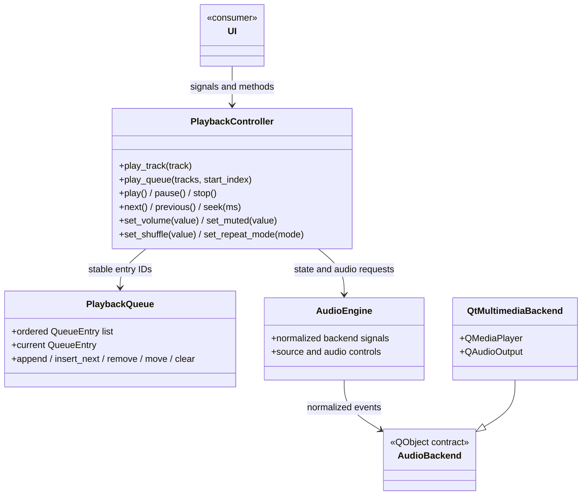

# Agent 2 — Audio subsystem contract

## Backend choice

The subsystem uses **PySide6 Qt Multimedia** as its only production playback
backend: `QMediaPlayer` decodes and plays one source at a time, with an attached
`QAudioOutput` for volume and mute. The implementation uses backend signals for
playback state, media status, duration, position, seekability, and errors. It
does not poll or create listener threads.

Qt Multimedia is a reasonable fit for this PySide6 desktop application. Current
Qt 6 documentation describes its FFmpeg backend as the default on desktop
platforms, including Windows, and documents `QAudioOutput` as the volume, mute,
and device-selection API. Codec coverage still depends on the Qt build and
platform. The older Windows Media Foundation backend is deprecated beginning
with Qt 6.10. The Windows packaging process must deploy Qt Multimedia and the
matching FFmpeg libraries when they are not already available on the target
machine. The Qt deployment tools can collect those binaries.

`libmpv` was not added as a second option. It would add a native runtime library,
Python binding, and Windows DLL deployment/ABI requirements. The official mpv
installation notes also describe most Windows builds as third-party builds.
Those costs are not justified for the playback, seek, and control requirements
here; if Qt's codec coverage proves insufficient for the target library, that
decision should be revisited with a packaging prototype.

References:

- [Qt Multimedia overview and backend/deployment notes](https://doc.qt.io/qt-6/qtmultimedia-index.html)
- [QMediaPlayer API](https://doc.qt.io/qt-6/qmediaplayer.html)
- [QAudioOutput API](https://doc.qt.io/qt-6/qaudiooutput.html)
- [Qt supported media formats](https://doc.qt.io/qt-6/videooverview.html)
- [mpv installation notes](https://mpv.io/installation/)

### Licensing and codec deployment

PySide6/Qt for Python is distributed under LGPLv3/GPLv3 or commercial terms;
the project must select a distribution model and comply with the applicable Qt
terms. Qt's documented FFmpeg binaries use LGPL and other permissive component
licenses and omit FFmpeg's optional GPL components, but a custom or replaced
FFmpeg build may have different obligations. Redistributed Qt/FFmpeg binaries
need their corresponding notices and deployment materials. Qt also cautions
that codec patents may carry separate royalties that Qt licensing does not
cover. Confirm the actual shipped binary configuration, notices, and required
codec rights before publishing an installer.

- [Qt for Python licensing](https://doc.qt.io/qtforpython-6/commercial/index.html)
- [Qt Multimedia licenses and attributions](https://doc.qt.io/qt-6/qtmultimedia-index.html)
- [FFmpeg license and legal considerations](https://ffmpeg.org/legal.html)

## Architecture



`PlaybackController` owns policy and is the UI-facing API. `PlaybackQueue`
owns ordered queue entries; each occurrence receives a distinct internal ID,
even when the same Track object is enqueued more than once. `AudioEngine`
normalizes backend events. `QtMultimediaBackend` wraps one `QMediaPlayer` and
one `QAudioOutput`. `TrackLike` is a structural typing contract only; the
library remains the owner of `core/models/track.py`.

## Integration API

Construct one `PlaybackController` on the GUI thread and connect UI controls to
its methods/signals. Pass the library's Track objects; `track.path` must resolve
to a local file. Do not control a Qt Multimedia object from a widget.

```python
from core.audio import PlaybackController

playback = PlaybackController(parent=main_window)
playback.current_track_changed.connect(show_track)
playback.playback_state_changed.connect(update_transport)
playback.position_changed.connect(update_seek_bar)
playback.duration_changed.connect(update_duration)
playback.queue_changed.connect(refresh_queue)
playback.error_occurred.connect(show_playback_error)

# During application shutdown:
application.aboutToQuit.connect(playback.shutdown)
```

### Signals

| Signal | Payload | Meaning |
|---|---|---|
| `current_track_changed` | `object` (`TrackLike` or `None`) | Selected track object changed. |
| `current_queue_index_changed` | `object` (`int` or `None`) | Active queue row changed, including consecutive occurrences of the same track. |
| `playback_state_changed` | `str` | One of `stopped`, `loading`, `playing`, `paused`, `error`. |
| `position_changed` | `int` | Playback position in milliseconds. |
| `duration_changed` | `int` | Current duration in milliseconds; zero means unknown. |
| `volume_changed` | `float` | Linear volume in the range 0.0–1.0. |
| `muted_changed` | `bool` | Output mute state; volume is preserved while muted. |
| `queue_changed` | `object` (`list[TrackLike]`) | New snapshot of ordered queue contents. |
| `shuffle_changed` | `bool` | Shuffle enabled state. |
| `repeat_mode_changed` | `str` | `off`, `all`, or `one`. |
| `error_occurred` | `str` | Human-readable path, backend, decode, or playback error. |

Signals are emitted when their state changes. In particular, `playing` is not
reported until the backend reports its playing state. Queue signals describe
queue contents; use `current_track` and `current_queue_index` to read the
current selection.

### Properties

`current_track`, `current_state`, `position`, `duration`, `volume`,
`is_muted`, `is_playing`, `is_paused`, `queue`, `shuffle_enabled`, and
`repeat_mode` are read-only. `current_state` and `repeat_mode` are strings.
`queue` returns a new list, so editing that list does not edit playback state.
`current_queue_index` is also exposed and is `None` when the playing row has
been removed from the queue.

### Methods

| Method | Contract |
|---|---|
| `play_track(track)` | Replace queue with one track and request playback. |
| `play_queue(tracks, start_index=0)` | Replace queue and start at the selected row. |
| `play()` | Start, resume, or restart the current track. If no current track exists, starts the first queued row. |
| `pause()` | Request pause while loading or playing. |
| `toggle_play_pause()` | Pause while loading/playing; otherwise start or resume. |
| `stop()` | Stop and reset position while retaining current selection and queue. |
| `next()` / `previous()` | Navigate using queue, shuffle, and repeat settings. |
| `seek(position_ms)` | Seek in milliseconds; negative targets clamp to zero and known durations cap the target. |
| `set_volume(volume)` | Set finite values clamped to 0.0–1.0; NaN maps to zero. |
| `set_muted(muted)` | Set mute separately from volume. |
| `set_shuffle(enabled)` | Enable/disable shuffle without interrupting current playback. |
| `set_repeat_mode(mode)` | Accept `off`, `all`, `one`, or a `RepeatMode`; invalid values raise `ValueError`. |
| `add_to_queue(track)` | Append an occurrence; duplicates are allowed. |
| `play_next(track)` | Insert an occurrence after current; if there is no current row, insert at the front. |
| `remove_from_queue(index)` | Remove one row. Removing the active row leaves that track playing as a detached current item. |
| `move_queue_item(source, destination)` | Move to the destination's final index while preserving active-entry identity. |
| `clear_queue()` | Clear queued rows while allowing the current track to finish. |
| `shutdown()` | Stop and release audio resources; safe to call repeatedly. |

## State and failure behavior

The controller state values are `stopped`, `loading`, `playing`, `paused`,
and `error`.

- Selecting a new track resets its public position and adopts the library
  duration as an initial estimate. The backend's nonzero duration supersedes
  that estimate when available.
- A valid path enters `loading`; only a backend `PlayingState` event enters
  `playing`. Backend pause events enter `paused`.
- A missing path fails immediately. Invalid media, unsupported formats,
  resource/backend errors, and unexpected stops enter `error`, emit
  `error_occurred`, and leave the controller usable for another track.
- If Qt Multimedia object initialization raises, `AudioEngine` installs a
  fail-safe unavailable backend. The next playback request reports the reason
  via `error_occurred` rather than crashing controller construction.
- A stop requested through the controller is an intentional state transition.
  End-of-media is handled from the backend status signal, not a polling loop.
- Rapid track changes replace the source on the one player instance. Qt owns
  event delivery; there are no extra listener threads.

## Queue semantics

The queue stores stable IDs per occurrence rather than relying on Track
equality or mutable row indices. Reordering rows does not change the current
entry. Removing noncurrent rows does not change selection. Removing the active
row keeps the Track playing, records the next-row boundary, and lets
`next()`/natural completion continue from that boundary. `clear_queue()` removes
upcoming rows and leaves the active Track playing; when it ends, playback stops
unless more rows have since been added.

`play_queue([], start_index=0)` clears and stops. An empty queue rejects a
nonzero start index; nonempty out-of-range indices raise `IndexError` without
changing the current queue.

## Shuffle and repeat

Shuffle and repeat are independent. The queue's stored ordering is never
shuffled. Enabling shuffle builds a randomized bag of queue-entry IDs excluding
the current entry. Advancing consumes the bag, so an entry does not repeat
within that pass. A history plus cursor gives Previous/Next coherent behavior
when stepping backward and forward. `play_next` entries are prioritized over
the randomized bag; appends join the bag. Queue removals prune pending IDs and
reordering leaves the current shuffle pass intact. Disabling shuffle discards
the shuffled navigation cursor and resumes by the original queue order from
the current row.

At a repeat-all cycle boundary, the next bag contains all queued entries except
the current one. If there is more than one candidate, its first entry is
adjusted to avoid immediately replaying the prior entry when possible. A
single-entry repeat-all queue replays that entry.

| Repeat | End of current track | Manual Next |
|---|---|---|
| `off` | Advance if an entry remains; otherwise stop. | Advance if possible; otherwise stop. |
| `all` | Advance and wrap at the queue end. | Advance and wrap at the queue end. |
| `one` | Replay current entry. | Advance according to queue/shuffle order. |

Previous restarts the current track when its position is greater than the
default 3,000 ms threshold. The threshold is configurable with
`previous_restart_threshold_ms` on the controller. At the beginning with
repeat off, Previous restarts the current track; with repeat all it wraps to
the last entry.

## Volume and seeking units

All time values are integer milliseconds from Qt's `QMediaPlayer` events.
Volume is a linear float between 0.0 and 1.0. Mute does not change the stored
volume, so unmute restores the previous level. `QAudioOutput` uses a
single-player default output; output-device selection is not exposed in this
contract.

Seeking uses backend seekability events. A seek request during loading is
stored and applied after the backend reports a seekable source. Targets are
clamped to zero and, when known, the current duration. If the source never
becomes seekable, the pending request is dropped on invalid/no-media status.

## Dependencies, tests, and results

- Runtime dependency: **PySide6 with Qt Multimedia**. Tested here with
  PySide6 6.11.2. No `pygame`, `mutagen`, or libmpv playback dependency is used
  by this subsystem.
- Root dependency and packaging files were intentionally left unchanged under
  the file-ownership rules. The integration branch must add/deploy PySide6 as
  part of the PySide6 migration.
- Deterministic controller and queue tests use a signal-compatible fake
  backend and do not need speakers.
- The generated WAV integration test verifies that the installed Qt Multimedia
  backend loads a small PCM WAV source. It does not prove audible output.
- Run headlessly with:

  ```powershell
  $env:QT_QPA_PLATFORM = "offscreen"
  python -m pytest -q tests/audio
  ```

- Result on the audio branch: **26 passed**. Actual audible playback, device
  switching, and Windows installer deployment still require verification on a
  Windows machine with a playback device and the final packaged Qt runtime.

## Known limits and deliberately omitted features

- Codec/container support varies with the Qt/FFmpeg binaries delivered with
  the application. Probe target formats on the packaged Windows build; this
  subsystem does not promise support for every format.
- Qt's playback API is event-driven, but exact startup, seek, and decode error
  behavior still depends on its multimedia backend and media file.
- This implementation does not expose gapless playback, crossfade, ReplayGain,
  normalization, playback speed, or equalizer controls. No DSP stage is
  provided, so advertising an equalizer or crossfade would be misleading.
- Only one `QMediaPlayer` is used. Crossfade needs overlapping decoders/output
  and a tested gain ramp; this implementation does not provide either.
- No output-device picker is exposed yet. `QAudioOutput` supports device
  assignment, but selecting/recovering devices needs UI and Windows device
  lifecycle testing.
